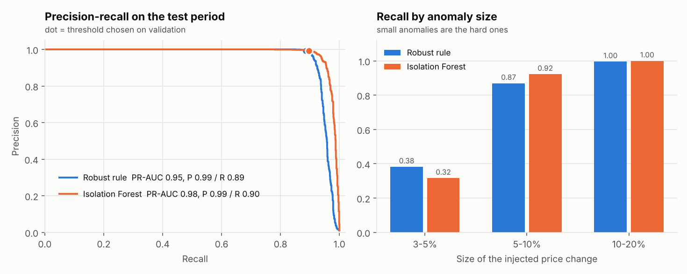
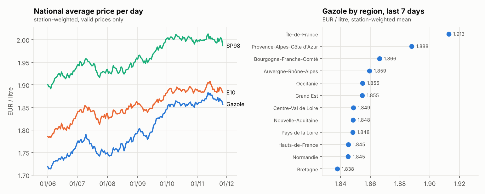

# carburant

Fuel-price data platform and AI assistant: ELT pipeline into a star-schema warehouse with dbt
data-quality tests, daily orchestration with Airflow, CI/CD, price-anomaly detection evaluated on
injected anomalies, and a LangGraph agent that answers French questions with a read-only SQL tool
and retrieval over the project documentation.

> **Read this first.**
> - **Data is synthetic.** The official feed ([Prix des carburants en France, data.gouv.fr][src])
>   was not reachable from the build environment. The parser targets the official XML format, and
>   a generator writes daily files in that exact format. Point `carburant ingest --url` at the real
>   feed to use real data. All numbers below describe the simulation.
> - **Local stack.** DuckDB stands in for BigQuery and a date-partitioned folder for Cloud Storage.
>   The dbt project has a `bigquery` target and BigQuery partitioning/clustering configs, but
>   **nothing was run on GCP** (no credentials here).
> - **No LLM is called.** The agent's router is rule-based, so answers are reproducible; an
>   `llm_fn` hook can reword answers without changing their numbers.

[src]: https://www.data.gouv.fr/datasets/fuel-prices-in-france-2

## Architecture

```
official XML feed ──fetch──> lake/raw/date=YYYY-MM-DD/prix.xml        (Cloud Storage layout)
                                  │ parse (lxml, ISO-8859-1, both unit formats)
                                  v
                    lake/staging/*.parquet  ──load──>  warehouse: schema raw   (the "L")
                                                          │ dbt build          (the "T")
                                                          v
              stg_prix ── reason? ──> quarantine_prix (5 rules)      34 data tests
                  │ valid
                  v
   fct_prix ── dim_station ── dim_localisation        mart_prix_journalier ──> anomaly detection
       │   └── dim_carburant                          mart_dashboard ──────> BI dashboard
       └────── dim_date                                       │
                                                              v
                 LangGraph agent: route ──> SQL tool (read-only, parameterised) ──> answer + sources
                                      └──> BM25 retrieval over docs ──────────────┘   (or abstain)

Airflow DAG (daily): ingest >> stage >> load >> dbt_build >> anomalies          FastAPI: /ask ...
```

## Quickstart

Python 3.12+.

```bash
pip install -e ".[dev]"
carburant run --stations 2000 --days 180     # whole pipeline + reports/results.md (~50 s)
pytest -q                                    # 77 tests (builds a warehouse, runs dbt build)
carburant ask "Quelle station est la moins chère pour le gazole à Lyon cette semaine ?"
uvicorn carburant.api:app --port 8000        # POST /ask, GET /cheapest, /anomalies, /quality
```

Real data: `carburant ingest --url <daily file URL> --date 2026-11-05`, then
`carburant stage && carburant load && carburant dbt && carburant anomalies`.

## Results (full run: 2,000 stations, 180 days, seed 42)

Full tables, failures and figures: [`reports/results.md`](reports/results.md).

**Warehouse and data quality.** 472,293 price rows staged; 5,220 quarantined (1.10 %) for five
reasons (duplicate, out of range, missing price, bad timestamp, unknown fuel); every row is
accounted for. dbt builds 10 models and runs 34 data tests, all passing. All 5,220 injected defects
were caught with no clean row quarantined; the rules were written for these defect types, so this
shows they work as specified, not that they would catch unknown errors.

**Anomaly detection.** Price anomalies of ±3–20 % injected into 1 % of daily prices; time split
50/25/25 (fit / choose threshold / test once); 1,173 anomalies in the test period.

| Detector | Precision [95% CI] | Recall [95% CI] | PR-AUC | Recall on 3–5 % anomalies |
|---|---|---|---|---|
| Robust rule (MAD z-scores) | 0.99 [0.99, 1.00] | 0.89 [0.87, 0.90] | 0.95 | 0.38 |
| Isolation Forest | 0.99 [0.99, 1.00] | 0.90 [0.88, 0.91] | 0.98 | 0.32 |

The two are close; the training-free rule is nearly as good. Small anomalies are mostly missed. On
data with no injected anomaly the rule flags 0.11 % of prices (false alarms by construction).



**Agent.** 45 held-out questions (28 data, 12 documentation, 5 out of scope), written before the
agent saw them; expected answers come from an independent pandas oracle.

| | Correct |
|---|---|
| Data questions | 21 / 28 |
| Documentation questions | 11 / 12 |
| Out-of-scope (must decline) | 4 / 5 |
| **Total** | **36 / 45 (80 %)** |

Every answered question cites its source (SQL query or documentation section). Median latency
34 ms (warm, in-process, no network, no LLM). The router was frozen after the first evaluation
so the score stays honest; failures are paraphrases outside its rules ("pas cher", "Top 3 des",
"a-t-il augmenté", "anormaux"), the name "SP95-E10", a motorway-only average it cannot express,
one retrieval miss, and one hallucination: a train-ticket price question answered with a fuel price.

**Orchestration and CI.** The Airflow DAG was parsed by Airflow 3.1.8 and run end to end with
`airflow dags test` (five tasks, success, about 30 s). CI runs ruff and pytest on Python 3.12 and
3.13, plus an Airflow job that parses the DAG.



## Design choices

- **ELT with quarantine, not deletion:** bad rows stay queryable with a reason; a dbt test checks
  every staged row lands in exactly one of fact or quarantine.
- **Defects and anomalies are injected with ground truth**, so quality and detection are measured,
  not asserted.
- **Time-based split** for anomaly detection: the threshold is chosen on a later period than the
  fit, and the test period is used once.
- **Read-only, parameterised SQL tool:** the agent never writes free SQL; zone columns are
  allow-listed.
- **Held-out agent evaluation with an independent oracle**, and the failures are published.

## Limitations

- Synthetic data; nothing here is a claim about real prices or real anomaly rates.
- Not deployed to GCP: BigQuery, Cloud Storage and Cloud Run are configured or documented, not run.
  No Looker Studio report was built; `mart_dashboard` is the table one would connect.
- The Docker image was not built (no daemon here); its steps were run in a clean virtualenv.
- The agent is rule-based: it handles the phrasings it was designed for and fails on others
  (20 % of the held-out set). An LLM router would be the natural next step.
- No regulatory texts in the retrieval corpus; only project documentation.

## Layout

```
src/carburant/   config, geo, ingest, synthetic, warehouse, anomaly, rag, tools, agent,
                 evaluate, dashboard, report, cli, api; docs/ (retrieval corpus, French)
dbt/             models (staging, marts), macros (generic tests), seeds, profiles (duckdb, bigquery)
airflow/         dags/carburant_daily.py, check_dag.py
eval/            questions.json (held-out agent evaluation set)
reports/         generated results and figures (committed)
tests/           77 tests
```
