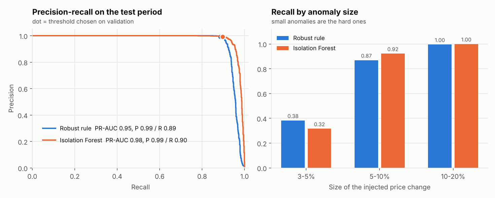
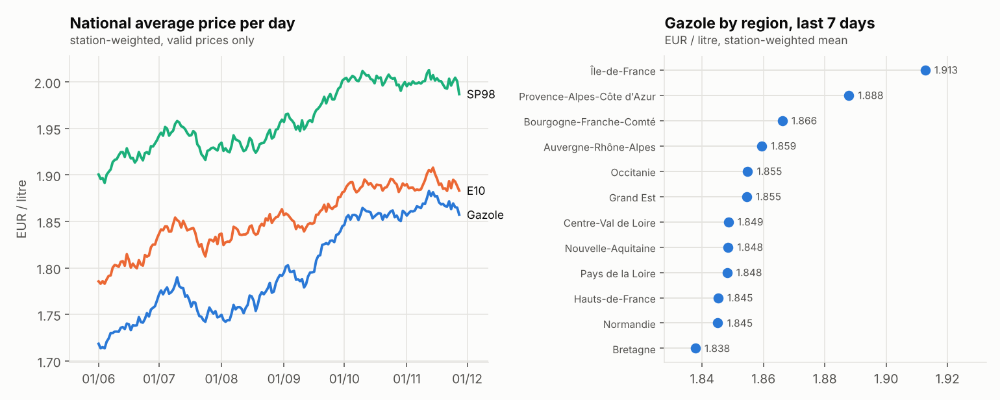

# Results

Auto-generated by `carburant run`. **Synthetic data** in the official format: the numbers describe the simulation, not the real fuel market.

Run: 2000 stations, 180 days, seed 42.

## Warehouse and data quality

- Price rows staged: 472,293; in the fact table: 467,073; quarantined: 5,220 (1.10 %). Every staged row is accounted for: yes.
- Quarantine reasons: bad_timestamp 439, duplicate 2,732, missing_price 478, out_of_range 1,352, unknown_fuel 219.
- dbt build: 10 models, 34 data tests (34 pass).
- Injected defects caught: 5,220 / 5,220 (recall 1.000), clean rows wrongly quarantined: 0. The rules were written for these defect types, so this shows they work as specified, not that they catch unknown errors.

## Anomaly detection

Anomalies of ±3-20 % injected into 1 % of daily prices. Time split: fit 235,794 rows, threshold 115,842, test 115,437 rows (1173 anomalies).

| Detector | Precision [95% CI] | Recall [95% CI] | F1 | PR-AUC | Recall 3-5 % | Recall 5-10 % | Recall 10-20 % |
|---|---|---|---|---|---|---|---|
| robust_rule | 0.99 [0.99, 1.00] | 0.89 [0.87, 0.90] | 0.94 | 0.95 | 0.38 (n=136) | 0.87 (n=360) | 1.00 (n=677) |
| isolation_forest | 0.99 [0.99, 1.00] | 0.90 [0.88, 0.91] | 0.94 | 0.98 | 0.32 (n=136) | 0.92 (n=360) | 1.00 (n=677) |

On the data **without** injected anomalies the rule flags 522 of 467,073 daily prices (0.11 %), all false alarms by construction.

## Agent (RAG + SQL tool)

Two routers, same SQL tool and retrieval. **rules** is the v1 rule set (frozen); **ml** is a learned intent classifier (TF-IDF + logistic regression on generated paraphrases). The development set was used to build v2; the **test** set was committed before v2 existed and run once. Expected answers come from an independent pandas oracle. No large language model is called.

| Router | Set | Data | Docs | Out of scope | **All** | Out-of-scope answered | Median latency |
|---|---|---|---|---|---|---|---|
| rules | dev | 21/28 | 11/12 | 4/5 | **80 %** | 1 | 34.0 ms |
| rules | test | 19/28 | 10/10 | 4/7 | **73 %** | 3 | 33.4 ms |
| ml | dev | 28/28 | 11/12 | 5/5 | **98 %** | 0 | 35.4 ms |
| ml | test | 27/28 | 9/10 | 4/7 | **89 %** | 3 | 34.8 ms |

Every answered question cites a source (grounded rate 100 %). The same person wrote the training templates and the questions, so these scores are optimistic compared with real users.

Failures of the ml router on the test set:

- `t04` Quelle station vend le diesel au prix le plus bas dans le Finistère ? — routed to abstain
- `u10` Quelle est la règle pour un prix de 17,99 euros ? — top source None (intent abstain)
- `v02` Quel est le prix moyen d'un appartement à Lyon ? — answered as average
- `v05` Combien de stations de métro à Lille ? — answered as count_stations
- `v06` Quel est le prix du baril de Brent aujourd'hui ? — answered as average

## Dashboard

`mart_dashboard` is the table a Looker Studio or Power BI report connects to. No Looker Studio report was built (no GCP access here); this static view is drawn from the same table.

